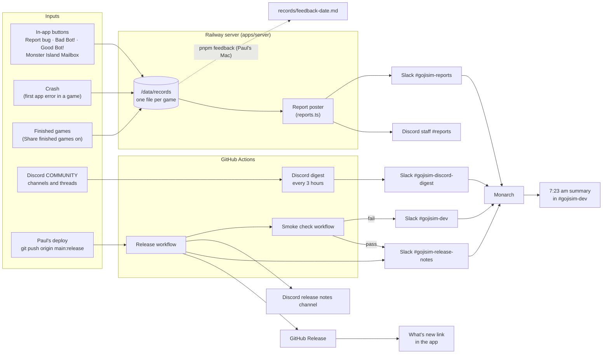

# Feedback and announcement flow

How testers' feedback reaches Monarch and Paul, and how each release is announced, with no manual step (#146). Setup steps are in [deploy.md](deploy.md) and [discord.md](discord.md); this page is the map.

## Inputs

- **In-app buttons** (the Test Site panel): Report bug, Bad Bot!, Good Bot! and Monster Island Mailbox. Each one uploads the game's record at once, with the note in it.
- **Crashes:** the first error from the app's own code in a game uploads the record with the error (#95), once per game.
- **Finished games:** with "Share finished games" on, each finished game uploads its record. This is where the win rates come from.
- **Discord discussion:** testers talk about bugs and ideas in the GojiSim server's COMMUNITY channels.
- **Releases and deploys:** Paul's push to `release` deploys the site (Railway), publishes a GitHub Release and starts the smoke check.

## Where each one goes

| Input                      | Goes to                                                                              | How                                                                                                                                   |
| -------------------------- | ------------------------------------------------------------------------------------ | ------------------------------------------------------------------------------------------------------------------------------------- |
| Button reports and crashes | `/data/records` on the server's volume                                               | `POST /api/games`, one file per game, replaced on each upload                                                                         |
| Each new report or crash   | Discord staff **#reports** and Slack **#gojisim-reports**                            | The server posts once per entry, at most 5 per upload; the upload never waits; no decklists; mentions off (#137, #146)                |
| Finished games             | `/data/records`                                                                      | The same upload; nothing is posted                                                                                                    |
| Discord COMMUNITY messages | Slack **#gojisim-discord-digest**                                                    | A GitHub Action every 3 hours with Paul's bot, read-only (#140, #148); a message is never posted twice; STAFF and INFO are never read |
| A release                  | GitHub Releases, Slack **#gojisim-release-notes**, the Discord release notes channel | The Release workflow, from each PR's "Release notes" section (#122, #135)                                                             |
| The deploy                 | Slack **#gojisim-release-notes** (pass) or **#gojisim-dev** (fail)                   | The smoke check plays a short game on the live site (#92)                                                                             |
| The latest release         | The app's "What's new" link                                                          | Read from GitHub's API, with a "New" dot until opened (#135)                                                                          |

The smoke check's own game is marked `smokeCheck`, so it's never posted as a report and never counts in the win rates.

## Who reads what, and when

- **Monarch** reads Slack when Paul prompts it: "check slack", and its check-ins. Its summary at 7:23 am Central in #gojisim-dev covers #gojisim-reports, #gojisim-discord-digest (posted every 3 hours) and the release and smoke results.
- **Paul** reads Discord: #reports, and the community channels directly. He decides what becomes work.
- **Mecha** watches #gojisim-dev by itself (`pnpm slack-watch`, started every session; an unchecked Monarch message comes back every 15 minutes until read, #148), acts on Monarch's messages without Paul relaying, and works from GitHub issues.

**From report to issue:** Monarch and Paul triage the reports together. A report worth acting on becomes a GitHub issue (the issue forms), with labels: `source:tester`, an `area:` label, and `owner:mecha` when Mecha takes it. It gets a milestone, and the issue names the record file and the `--at` index from the report's post, so the game can be replayed. The PR that fixes it says `Closes #N`.

## When `pnpm feedback` is still useful

The posts carry what a person needs to triage: the note, where it happened and the file. `pnpm feedback` on Paul's Mac (docs/deploy.md) adds what only the records can give:

- The bot's own analysis of a Bad Bot! or Good Bot! move: its search at that moment, the moves it weighed and their values.
- The human's win rate by bot level, over finished games.
- A report's game, downloaded for `pnpm bot-explain`, `pnpm bot-positions --from` or "Load a game record".

## Secrets and variables

Names only; the values live where they're set and never in the repo.

| Name                                                                   | Set in                                             | Used by                                                     | Missing means                                                                             |
| ---------------------------------------------------------------------- | -------------------------------------------------- | ----------------------------------------------------------- | ----------------------------------------------------------------------------------------- |
| `DISCORD_REPORTS_WEBHOOK`                                              | Railway variable                                   | The server's report poster                                  | No posts to Discord #reports (logged once per server start)                               |
| `SLACK_REPORTS_WEBHOOK`                                                | Railway variable                                   | The server's report poster                                  | No posts to Slack #gojisim-reports (logged once)                                          |
| `GOJISIM_TEST_SITE`                                                    | Railway variable                                   | The server and app                                          | `off` turns the buttons and uploads off; default on                                       |
| `RECORDS_DIR`                                                          | Railway variable                                   | The server                                                  | Records go to `/data/records` (the default)                                               |
| `GOJISIM_PASSWORD`, `SESSION_SECRET`                                   | Railway variables                                  | The password gate                                           | No password: the site is open to anyone (the deploy log warns)                            |
| `GOJISIM_AUTH`                                                         | Railway variable                                   | The server (#150)                                           | `password` (the default) keeps the shared password; `discord` switches to Discord sign-in |
| `DISCORD_CLIENT_ID`, `DISCORD_CLIENT_SECRET`, `DISCORD_TESTER_ROLE_ID` | Railway variables                                  | Discord sign-in                                             | With `GOJISIM_AUTH=discord`, the server refuses to start and names the missing one        |
| `DISCORD_GUILD_ID`                                                     | Railway variable, and a GitHub repository variable | Discord sign-in (the Tester role check), the Discord digest | As above; and no digest                                                                   |
| `SMOKE_LOGIN_TOKEN`                                                    | Railway variable and GitHub secret                 | The smoke check's sign-in with Discord sign-in on           | With `GOJISIM_AUTH=discord`, the smoke check fails at "Log in"                            |
| `GOJISIM_DB`                                                           | Railway variable (optional)                        | The players database                                        | Defaults to `/data/gojisim.db`, backed up before each update to `/data/backups/`          |
| `RAILWAY_GIT_COMMIT_SHA`                                               | Set by Railway                                     | `/healthz`                                                  | The smoke check can't see the deploy and times out                                        |
| `SLACK_RELEASE_WEBHOOK`                                                | GitHub secret                                      | The Release workflow, the smoke check's pass line           | No release post to Slack; smoke passes aren't posted                                      |
| `DISCORD_RELEASE_WEBHOOK`                                              | GitHub secret                                      | The Release workflow                                        | No release post to Discord                                                                |
| `SITE_PASSWORD`                                                        | GitHub secret                                      | The smoke check                                             | The check can't log in and fails at "Log in"                                              |
| `SLACK_DEV_WEBHOOK`                                                    | GitHub secret                                      | The smoke check's failure message                           | Failures go to #gojisim-release-notes instead                                             |
| `DISCORD_BOT_TOKEN`                                                    | GitHub secret                                      | The Discord digest                                          | No digest (a warning in the run)                                                          |
| `SLACK_DIGEST_WEBHOOK`                                                 | GitHub secret                                      | The Discord digest                                          | No digest (a warning in the run)                                                          |
| `DISCORD_GUILD_ID` (digest)                                            | GitHub repository variable                         | The Discord digest                                          | No digest (a warning in the run)                                                          |
| `~/.ssh/railway_ed25519`                                               | Paul's Mac                                         | `pnpm feedback`'s download over `railway ssh`               | The download fails and prints the manual command                                          |

A missing webhook or a failed post never breaks an upload, a release or a deploy. Each is a warning in the server log or the workflow's run.
